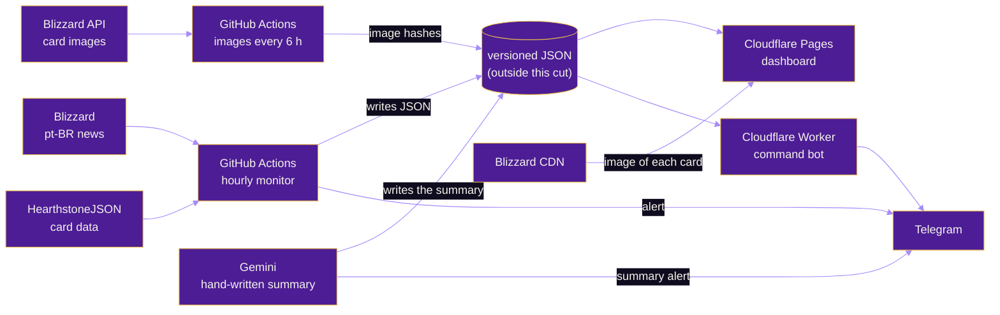
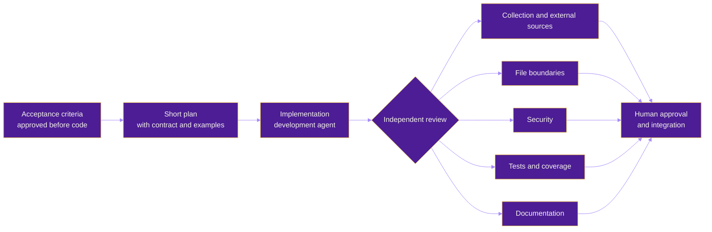

<p align="center">
  
</p>

<p align="center"><a href="README.md">Português</a> · <b>English</b></p>

<p align="center">
  <a href="https://dashboard-hs.pages.dev"></a>
</p>

<p align="center">
  
  
  
  
  
  
</p>

<p align="center">
  
  
  
  
  
  
  
  
  
  
  
  
</p>

<p align="center"><sub>Built with Claude · Python · JavaScript · GitHub Actions · Cloudflare · Telegram</sub></p>

<p align="center"></p>

> **Showcase repository, read-only.** This is a cut of the project: code, tests and workflows only. It has no data and no secrets, the workflows are kept for reference only, and it **does not accept contributions**. The code may be read but not copied or reused without written permission: see the [LICENSE](LICENSE).
>
> The product (messages, dashboard, bot replies) is in Brazilian Portuguese. This page is an English overview.

# Dash'board HS

**Dash'board HS** gathers Hearthstone information in one place: patches, news and the Standard and Wild meta decks. It alerts on Telegram when a patch or news post is released, with a summary in Portuguese and the list of changed cards, keeps the whole history in a dashboard with official cards in 3D, and answers commands right in Telegram.

It runs on its own, with no server, on free tiers: collection is a scheduled GitHub Actions workflow, the dashboard is a static page on Cloudflare Pages and the command bot is a Cloudflare Worker.

## What it does

<table>
  <tr>
    <td width="72" align="center"></td>
    <td><b>Patch alerts on Telegram</b><br>Every hour it checks Blizzard's official news (pt-BR) and HearthstoneJSON. When a patch is out, it sends the post link and the changed cards; if collection fails, it says so instead of staying silent.</td>
  </tr>
  <tr>
    <td align="center"></td>
    <td><b>Card diff</b><br>Compares HearthstoneJSON builds and lists buffs, nerfs and cost, attack, health and text changes for each changed card.</td>
  </tr>
  <tr>
    <td align="center"></td>
    <td><b>Own AI summary</b><br>News and patches get a bullet-point summary written with Gemini from the post and the card diff, used on Telegram and in the dashboard.</td>
  </tr>
  <tr>
    <td align="center"></td>
    <td><b>Dashboard</b><br>History of patches and news, a detail view per patch, card search and a Meta section, at <a href="https://dashboard-hs.pages.dev">dashboard-hs.pages.dev</a>. Changed cards show the official pt-BR image, tilt with the mouse or finger, flip to show the back and, for buffs and nerfs, switch between the previous and current version. Plain HTML, CSS and JavaScript, no framework.</td>
  </tr>
  <tr>
    <td align="center"></td>
    <td><b>Command bot</b><br>Look up patches, cards, news and meta decks right in Telegram.</td>
  </tr>
  <tr>
    <td align="center"></td>
    <td><b>Meta decks</b><br>Per-class shortcuts, in Standard and Wild, to decks and stats on HSReplay and HSGuru. The project reads neither site: it only builds links.</td>
  </tr>
  <tr>
    <td align="center"></td>
    <td><b>Site security</b><br>Security headers in <a href="site/_headers"><code>site/_headers</code></a> (content policy limited to the site itself, Google Fonts and image CDNs, no <code>unsafe-inline</code> for scripts), with tests that pin the policy hash.</td>
  </tr>
</table>

## Bot commands

| Command | Reply |
| --- | --- |
| `/patch [version]` | The latest patch, or the requested version, with summary and changed cards |
| `/carta <name>` | The current card and its change history across patches |
| `/historico` | The 10 most recent patches |
| `/noticias [search or number]` | Recent news, one specific post with its summary, or a topic search |
| `/decks <class> [padrão\|wild]` | Links to the class's decks on HSReplay and HSGuru, in both formats or the one asked |
| `/meta [class] [padrão\|wild]` | Links to meta stats on HSGuru and HSReplay |
| `/ajuda` | The command list and the dashboard link |

## How it works



## Layout of this repository

<table>
  <tr>
    <td width="72" align="center"></td>
    <td>

```text
dashboard-hs-project/
├── src/hsds/            collectors, card diff, summary and Telegram delivery (Python)
├── bot/                 Telegram Cloudflare Worker (JavaScript)
├── site/                static dashboard (HTML, CSS and site/js)
├── tests/               pytest and node --test suites, with no network access
├── docs/workflows/      GitHub Actions workflows, reference only
└── docs/imagens/        illustrations for this README
```

</td>
  </tr>
</table>

## Development and tests

<table>
  <tr>
    <td width="72" align="center"></td>
    <td>Requires Python 3.12 and, for the dashboard and bot tests, Node 22. Tests never touch the network: they use pages and JSON saved in <code>tests/dados/</code>. A failing test is never switched off: it becomes a fix.</td>
  </tr>
</table>

```bash
python -m pip install -e ".[teste]"
python -m pytest
node --test tests/js/*.test.mjs
```

## How it was built: the agent workflow

<table>
  <tr>
    <td width="72" align="center"></td>
    <td>The project was developed with <b>AI agents orchestrated by a human</b>: one development agent writes the code, and read-only specialists (which never edit files) do the independent review. Each layer of the repository has file boundaries that do not overlap, and integration only happens with explicit human approval.</td>
  </tr>
</table>



| Step | What happens |
| --- | --- |
| **Acceptance criteria** | Each milestone starts with a short "criterion → how to verify" table, approved before any code. |
| **Plan and contract** | Files the task may touch, signatures and concrete examples, to prevent scope drift. |
| **Implementation** | One agent writes code and tests within the task's boundaries; one logical change per commit. |
| **Independent review** | Five read-only specialists (collection, file boundaries, security, tests and documentation) examine the diff before integration; a blocking finding becomes a fix, a suggestion is applied or justified. |
| **Approval** | Nothing reaches `main` without explicit human approval. |

## Milestones

| Milestone | Delivery |
| --- | --- |
| M0 · Foundation | Repository, documentation, workflow and test message |
| M1 · Patch notes | pt-BR collection, card diff, JSON and Telegram alert |
| M2 · Dashboard | Page with history, detail view and card search |
| M2b · AI summary | Bullet-point summary for patches and news |
| M2c · Historical backfill | Older patches and news in the dashboard |
| M3 · Bot | Worker with `/patch`, `/carta`, `/historico` and `/noticias` |
| M4 · Meta | `/decks`, `/meta` and a Meta section in the dashboard |
| M5 · Visual | Official cards in 3D with before and after, own icons and the D'arc visual identity |

## Sources and limits

<table>
  <tr>
    <td width="72" align="center"></td>
    <td>
      <ul>
        <li>Sources: Blizzard's official news, open data from <a href="https://hearthstonejson.com">HearthstoneJSON</a> and Blizzard's Hearthstone data API, only for the address of card images. HSGuru and HSReplay appear only as shortcuts, because their terms forbid collection.</li>
        <li>The dashboard does not republish Blizzard text: it shows its own summary and a link to the original post. This repository does not store card images: the dashboard loads them from Blizzard's CDN, with the HearthstoneJSON render as a fallback, and credits Blizzard in the footer.</li>
        <li>Personal, non-commercial project. Hearthstone is a trademark of Blizzard Entertainment; this project is neither affiliated with nor endorsed by it.</li>
        <li>Technology icons come from <a href="https://simpleicons.org">Simple Icons</a> (CC0); each brand belongs to its owner.</li>
        <li>View-only license: see the <a href="LICENSE">LICENSE</a>.</li>
      </ul>
    </td>
  </tr>
</table>
