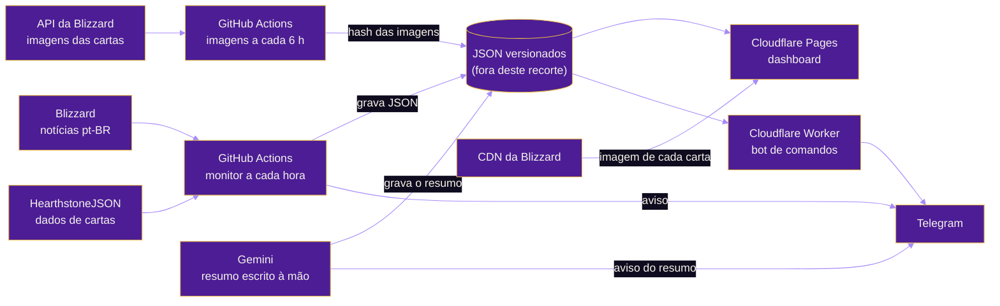
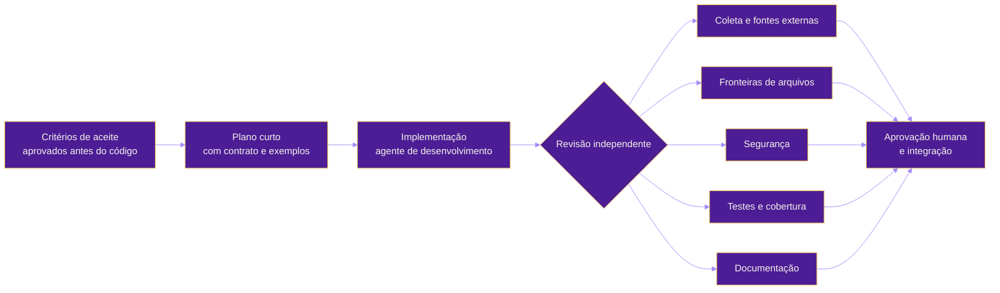

<p align="center">
  
</p>

<p align="center"><b>Português</b> · <a href="README.en.md">English</a></p>

<p align="center">
  <a href="https://dashboard-hs.pages.dev"></a>
</p>

<p align="center">
  
  
  
  
  
  
</p>

<p align="center">
  
  
  
  
  
  
  
  
  
  
  
  
</p>

<p align="center"><sub>Feito com Claude · Python · JavaScript · GitHub Actions · Cloudflare · Telegram</sub></p>

<p align="center"></p>

> **Repositório de vitrine, somente leitura.** Este é um recorte do projeto: só o código, os testes e os workflows. Não tem dados nem segredos, os workflows ficam só como referência e **não aceita contribuições**. O código pode ser lido, mas não copiado nem reutilizado sem permissão por escrito: veja a [LICENSE](LICENSE).

# Dash'board HS

**Dash'board HS** reúne as informações de Hearthstone num só lugar: patches, notícias e os decks do meta Padrão e Selvagem. Avisa no Telegram quando sai um patch ou uma notícia, com um resumo em português e a lista das cartas alteradas, guarda todo o histórico num dashboard com as cartas oficiais em 3D e responde a comandos direto no Telegram.

Roda sozinho, sem servidor e em planos gratuitos: a coleta é um workflow agendado do GitHub Actions, o dashboard é uma página estática no Cloudflare Pages e o bot de comandos é um Cloudflare Worker.

## Sumário

- [I. O que ele faz](#i-o-que-ele-faz)
- [II. Comandos do bot](#ii-comandos-do-bot)
- [III. Como funciona](#iii-como-funciona)
- [IV. Estrutura do repositório](#iv-estrutura-do-repositório)
- [V. Desenvolvimento e testes](#v-desenvolvimento-e-testes)
- [VI. Como foi construído: o fluxo de agentes](#vi-como-foi-construído-o-fluxo-de-agentes)
- [VII. Marcos](#vii-marcos)
- [VIII. Fontes e limites](#viii-fontes-e-limites)

## I. O que ele faz

<table>
  <tr>
    <td width="72" align="center"></td>
    <td><b>Aviso de patch no Telegram</b><br>Verifica a cada hora o site oficial da Blizzard (pt-BR) e o HearthstoneJSON. Quando sai patch, manda a mensagem com o link da notícia e as cartas alteradas; se a coleta falhar, avisa em vez de ficar em silêncio.</td>
  </tr>
  <tr>
    <td align="center"></td>
    <td><b>Diff de cartas</b><br>Compara as builds do HearthstoneJSON e lista buff, nerf, custo, ataque, vida e texto de cada carta alterada.</td>
  </tr>
  <tr>
    <td align="center"></td>
    <td><b>Resumo próprio por IA</b><br>Notícias e patches de Hearthstone ganham um resumo em tópicos, escrito com o Gemini a partir da notícia e do diff de cartas, usado no Telegram e no dashboard.</td>
  </tr>
  <tr>
    <td align="center"></td>
    <td><b>Dashboard</b><br>Histórico de patches e notícias, detalhe de cada patch, busca por carta e seção Meta, em <a href="https://dashboard-hs.pages.dev">dashboard-hs.pages.dev</a>. As cartas alteradas aparecem com a imagem oficial em pt-BR, inclinam com o mouse ou o dedo, viram para mostrar o verso e, em buffs e nerfs, trocam entre a versão anterior e a atual. HTML, CSS e JavaScript puros, sem framework.</td>
  </tr>
  <tr>
    <td align="center"></td>
    <td><b>Bot de comandos</b><br>Consulta patches, cartas, notícias e decks do meta direto no Telegram.</td>
  </tr>
  <tr>
    <td align="center"></td>
    <td><b>Decks do meta</b><br>Atalhos por classe, em Padrão e Wild, para os decks e as estatísticas do HSReplay e do HSGuru. O projeto não lê nenhum desses sites: só monta os links.</td>
  </tr>
  <tr>
    <td align="center"></td>
    <td><b>Segurança do site</b><br>Cabeçalhos de segurança em <a href="site/_headers"><code>site/_headers</code></a> (política de conteúdo restrita ao próprio domínio, ao Google Fonts e aos CDNs de imagem, sem <code>unsafe-inline</code> em scripts), com testes que travam o hash da política.</td>
  </tr>
</table>

## II. Comandos do bot

| Comando | O que responde |
| --- | --- |
| `/patch [versão]` | O patch mais recente, ou a versão pedida, com resumo e cartas alteradas |
| `/carta <nome>` | A carta atual e o histórico de mudanças dela nos patches |
| `/historico` | Os 10 patches mais recentes |
| `/noticias [busca ou número]` | As notícias recentes, uma notícia específica com resumo ou a busca por assunto |
| `/decks <classe> [padrão\|wild]` | Links dos decks da classe no HSReplay e no HSGuru, nos dois formatos ou só no pedido |
| `/meta [classe] [padrão\|wild]` | Links das estatísticas do meta no HSGuru e no HSReplay |
| `/ajuda` | A lista de comandos e o link do dashboard |

## III. Como funciona



| Peça | Onde | O que faz |
| --- | --- | --- |
| Monitor | [`docs/workflows/monitor.yml`](docs/workflows/monitor.yml), [`src/hsds/`](src/hsds/) | Coleta, compara as cartas, avisa no Telegram e grava os JSON |
| Dashboard | [`site/`](site/) | HTML, CSS e JavaScript puros, sem framework; a imagem de cada carta vem direto do CDN da Blizzard, com o HearthstoneJSON de reserva |
| Bot | [`bot/`](bot/), [`docs/workflows/bot.yml`](docs/workflows/bot.yml) | Worker que só lê os JSON publicados, sem banco próprio |
| Testes | [`tests/`](tests/), [`docs/workflows/testes.yml`](docs/workflows/testes.yml) | pytest e node --test a cada mudança, sem acesso à rede |

## IV. Estrutura do repositório

<table>
  <tr>
    <td width="72" align="center"></td>
    <td>

```text
dashboard-hs-project/
├── src/hsds/            coletores, diff de cartas, resumo e envio ao Telegram (Python)
├── bot/                 Cloudflare Worker do Telegram (JavaScript)
├── site/                dashboard estático (HTML, CSS e site/js)
├── tests/               testes em pytest e em node --test, sem acesso à rede
├── docs/workflows/      workflows do GitHub Actions, só como referência
└── docs/imagens/        ilustrações deste README
```

</td>
  </tr>
</table>

## V. Desenvolvimento e testes

<table>
  <tr>
    <td width="72" align="center"></td>
    <td>Requer Python 3.12 e, para os testes do dashboard e do bot, Node 22. Os testes nunca acessam a rede: usam páginas e JSON salvos em <code>tests/dados/</code>. Teste que falha não se desliga: vira correção.</td>
  </tr>
</table>

```bash
python -m pip install -e ".[teste]"
python -m pytest
node --test tests/js/*.test.mjs
```

Os segredos (token do bot, chat id e chaves do Cloudflare) ficam nos Secrets do GitHub e do Cloudflare, nunca no repositório.

## VI. Como foi construído: o fluxo de agentes

<table>
  <tr>
    <td width="72" align="center"></td>
    <td>O projeto foi desenvolvido com <b>agentes de IA orquestrados por um humano</b>: um agente de desenvolvimento escreve o código, e especialistas de leitura (que não editam arquivos) fazem a revisão independente. Cada camada do repositório tem fronteiras de arquivos que não se cruzam, e a integração só acontece com aprovação humana.</td>
  </tr>
</table>



| Etapa | O que acontece |
| --- | --- |
| **Critérios de aceite** | Cada marco começa com uma tabela curta "critério → como verificar", aprovada antes de qualquer código. |
| **Plano e contrato** | Arquivos que a tarefa pode tocar, assinaturas e exemplos concretos, para evitar desvio de escopo. |
| **Implementação** | Um agente escreve o código e os testes dentro das fronteiras da tarefa; uma mudança lógica por commit. |
| **Revisão independente** | Cinco especialistas de leitura (coleta, fronteiras de arquivos, segurança, testes e documentação) examinam o diff antes da integração; achado que bloqueia vira correção, achado que sugere é aplicado ou justificado. |
| **Aprovação** | Nada entra na `main` sem aprovação humana explícita. |

Regras que o processo impõe: teste que falha não se desliga; segredos só nos Secrets; fontes externas só depois de ler os termos de uso; decisões registradas com data, motivo e aprovação.

## VII. Marcos

| Marco | Entrega |
| --- | --- |
| M0 · Fundação | Repositório, documentação, workflow e mensagem de teste |
| M1 · Patch notes | Coleta pt-BR, diff de cartas, JSON e aviso no Telegram |
| M2 · Dashboard | Página com histórico, detalhe e busca de carta |
| M2b · Resumo por IA | Resumo em tópicos para patches e notícias |
| M2c · Histórico retroativo | Patches e notícias antigos no dashboard |
| M3 · Bot | Worker com `/patch`, `/carta`, `/historico` e `/noticias` |
| M4 · Meta | `/decks`, `/meta` e seção Meta no dashboard |
| M5 · Visual | Cartas oficiais em 3D com antes e depois, ícones próprios e a identidade visual da D'arc |

## VIII. Fontes e limites

<table>
  <tr>
    <td width="72" align="center"></td>
    <td>
      <ul>
        <li>Fontes: notícias oficiais da Blizzard, dados abertos do <a href="https://hearthstonejson.com">HearthstoneJSON</a> e a API de dados do Hearthstone da Blizzard, só para o endereço das imagens das cartas. O HSGuru e o HSReplay aparecem só como atalhos, porque os termos deles vetam a coleta.</li>
        <li>O dashboard não republica texto da Blizzard: mostra o resumo próprio e o link da notícia original. Este repositório não guarda as imagens das cartas: o dashboard as carrega do CDN da Blizzard, com o render do HearthstoneJSON de reserva, e credita a Blizzard no rodapé.</li>
        <li>Projeto pessoal e sem fins comerciais. Hearthstone é marca da Blizzard Entertainment; este projeto não é afiliado nem endossado por ela.</li>
        <li>Os ícones das tecnologias vêm do <a href="https://simpleicons.org">Simple Icons</a> (CC0); cada marca pertence ao seu dono.</li>
        <li>Licença de visualização, somente leitura: veja a <a href="LICENSE">LICENSE</a>.</li>
      </ul>
    </td>
  </tr>
</table>
